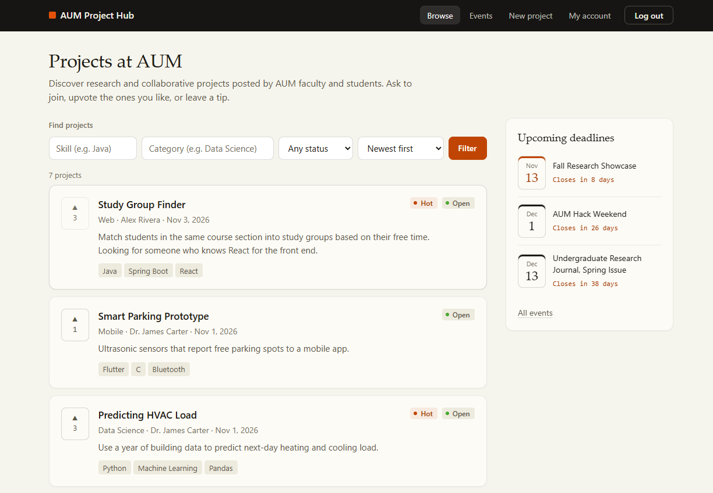
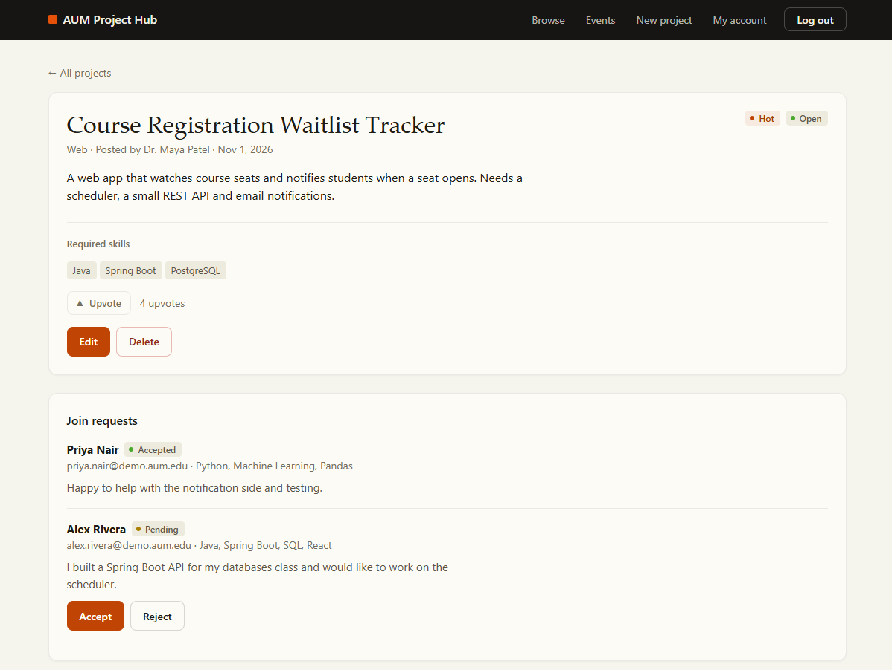
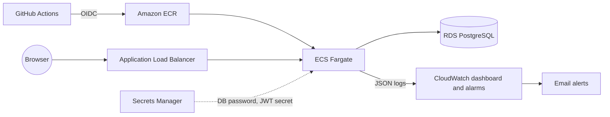

# AUM Project Hub

[](https://github.com/DShivaram01/aum-project-hub/actions/workflows/ci.yml)

A Spring Boot web app where AUM faculty and students post projects and others ask to join them.

At AUM there isn't a simple place where faculty can post a research or side project and students can ask to join. It usually happens over email or by word of mouth. I built this to fix that: faculty and students post projects, other people browse and filter them by skill, send a join request with a short message, and the project owner accepts or rejects it.

**[Live demo](http://aum-pr-LoadB-JuZAyVVHlFOR-1194787445.us-east-1.elb.amazonaws.com)**

The home page has one-click logins for a demo faculty account and a demo student account (password `demo1234`), so you can try both sides without registering. The demo is plain HTTP, so please don't reuse a real password if you register.

| Browse and filter projects | Owner view with join requests |
|---|---|
|  |  |

## What it does

- Register as a student or faculty member and log in (JWT)
- Post projects, edit or close them, and delete them
- Browse projects and filter by category, status, or skill
- Send a join request to someone else's project, and withdraw it while it's still pending
- As the owner, see the requests for your project and accept or reject them
- Edit your own profile (department, skills, short bio)
- See upcoming events (showcases, hackathons, journal issues) with their submission deadlines; faculty create them
- Enter your project in an upcoming event, either to present it, publish it, or both, when you post it or later
- Upvote other people's projects; anything with 3 or more upvotes is marked hot, and you can sort by hot
- Leave tips on a project idea; the author or the project owner can remove them

A few rules are enforced on the backend, not just in the UI: you can't request to join your own project, closed projects don't take requests, you can only send one request per project, and once a request is accepted or rejected it can't be changed again. Only faculty can create events, a submission deadline has to come before the event starts, entries close at the deadline, a project can be entered in an event once, and you can't upvote your own project.

## A few things worth pointing out

- **Duplicate join requests can't slip through.** The service checks for an existing request, but two requests landing at the same moment can both pass that check. A unique constraint on `(project_id, user_id)` is the real guarantee, and when it fires the API returns 409 instead of a 500.
- **No N+1 on the project list.** Upvote counts for every project come from one grouped query, not one count per project.
- **Deadlines don't depend on the server's time zone.** Event times are stored as UTC instants and the browser converts them to local time.
- **Deploys can't leave the site broken.** CI pushes to ECS with OIDC (no AWS keys in the repo), and if the new version fails its health checks, ECS rolls back on its own.

## Tech stack

- **Backend:** Java 17, Spring Boot 3.5, Spring Security with JWT, Spring Data JPA
- **Database:** PostgreSQL (H2 in tests)
- **Frontend:** plain HTML, CSS and JavaScript served by Spring Boot
- **Testing:** JUnit 5, Mockito, MockMvc (87 tests)
- **DevOps:** Docker, Docker Compose, GitHub Actions
- **AWS:** ECS Fargate, Application Load Balancer, RDS PostgreSQL, Secrets Manager, CloudWatch, CloudFormation

## How it's put together

```text
src/main/java/com/aum/projecthub/
├── config/       security setup, JWT, request logging
├── controller/   REST endpoints
├── service/      business rules (ownership checks, join request rules)
├── repository/   Spring Data JPA repositories
├── model/        JPA entities: User, Project, JoinRequest, Event, EventSubmission, Upvote, Tip
├── dto/          request/response objects, so entities and password hashes never leave the API
├── exception/    a few exceptions mapped to 400/403/404/409 in one handler
└── demo/         seeds demo accounts and projects when app.demo-data=true
src/main/resources/static/   the frontend
infra/aws/                   CloudFormation templates
```

It's a standard layered Spring Boot app. Controllers stay thin, services hold the rules, and repositories talk to the database.

There are seven tables. `users` and `projects` are the core, and each project has an owner. `join_requests` links a user to a project with a status and is unique on `(project_id, user_id)`. `events` holds showcases, hackathons and journal issues, and `event_submissions` is a project entered in an event, with `present` and `publish` flags and a unique `(event_id, project_id)`. `upvotes` is unique on `(project_id, user_id)`, and `tips` are short comments on a project.

### Login

Passwords are hashed with BCrypt. Logging in returns a JWT that's valid for 24 hours, and the frontend sends it as `Authorization: Bearer <token>`. A filter checks the token on every request, so there are no server-side sessions. Passwords are capped at 72 characters because BCrypt ignores anything after the first 72 bytes.

## API

<details>
<summary>All 30 endpoints</summary>

| Method | Endpoint | Who | What it does |
|--------|----------|-----|--------------|
| POST | `/api/auth/register` | anyone | create an account |
| POST | `/api/auth/login` | anyone | get a JWT |
| GET | `/api/users/me` | logged in | your profile |
| GET | `/api/users/{id}` | logged in | someone's profile |
| PUT | `/api/users/{id}` | that user | update your profile |
| GET | `/api/projects` | anyone | list projects, optional `category`, `status`, `skill` filters and `sort=hot` |
| GET | `/api/projects/{id}` | anyone | project details |
| POST | `/api/projects` | logged in | create a project |
| PUT | `/api/projects/{id}` | owner | update a project |
| DELETE | `/api/projects/{id}` | owner | delete a project with its requests, upvotes, tips and event entries |
| PUT | `/api/projects/{id}/upvote` | logged in, not owner | upvote (doing it twice is a no-op) |
| DELETE | `/api/projects/{id}/upvote` | logged in | remove your upvote |
| GET | `/api/projects/{id}/tips` | anyone | tips on a project |
| POST | `/api/projects/{id}/tips` | logged in | leave a tip |
| DELETE | `/api/tips/{id}` | author or project owner | remove a tip |
| GET | `/api/events` | anyone | upcoming events, soonest first |
| GET | `/api/events/{id}` | anyone | event details |
| POST | `/api/events` | faculty | create an event |
| PUT | `/api/events/{id}` | creator | update an event |
| DELETE | `/api/events/{id}` | creator | delete an event and its entries |
| GET | `/api/events/{id}/submissions` | anyone | projects entered in an event |
| GET | `/api/projects/{id}/submissions` | anyone | events a project is entered in |
| POST | `/api/projects/{id}/submissions` | owner | enter a project in an event (`eventId`, `present`, `publish`) |
| DELETE | `/api/submissions/{id}` | owner | withdraw an entry before the deadline |
| POST | `/api/projects/{id}/join-requests` | logged in | ask to join |
| GET | `/api/projects/{id}/join-requests` | owner | requests for your project |
| GET | `/api/join-requests/mine` | logged in | requests you've sent |
| PUT | `/api/join-requests/{id}` | owner | accept or reject |
| DELETE | `/api/join-requests/{id}` | requester | withdraw a pending request |
| GET | `/actuator/health` | anyone | health check, includes the database |

</details>

Errors come back as `{"error": "..."}`, or as a field-to-message map for validation errors. Status codes: 400 bad input, 401 not logged in, 403 not allowed, 404 not found, 409 conflict.

## Running it locally

## Running it locally

You need Docker (Docker Desktop on Windows or Mac). Clone the repo and start the app and PostgreSQL together:

```bash
git clone https://github.com/DShivaram01/aum-project-hub.git
cd aum-project-hub
docker compose up --build
```

The first build takes a few minutes while Maven downloads dependencies. Then open http://localhost:8080. Demo data is on in the compose file, so the demo logins work locally too. Stop it with Ctrl+C, and run `docker compose down -v` if you want to wipe the database and start fresh.

To run the app from your IDE or with Maven instead (needs Java 17), start only the database and run the app on your machine:

```bash
docker compose up -d postgres
./mvnw spring-boot:run          # Windows: .\mvnw.cmd spring-boot:run
```

In IntelliJ you can also just open the folder and run `ProjectHubApplication`. Every setting has a local default that matches the compose database, so there's nothing to configure. To override them, set `DB_URL`, `DB_USERNAME`, `DB_PASSWORD` or `JWT_SECRET` (at least 32 characters). Demo data is off in this mode, so set `APP_DEMODATA=true` if you want it.

If port 5432 or 8080 is already in use (a local Postgres install is the usual culprit), stop that service or change the left-hand port in `docker-compose.yml`.

Configuration comes from environment variables: `DB_URL`, `DB_USERNAME`, `DB_PASSWORD`, `JWT_SECRET` (at least 32 characters), and `APP_DEMODATA=true` if you want the demo data.

## Tests

```bash
./mvnw test
```

- Repository tests with `@DataJpaTest` cover the custom search query and the database constraints.
- Service tests with Mockito cover the business rules, including every join request rule.
- Integration tests with MockMvc start the whole app on H2 and go through real HTTP flows, including the security cases (401 without a token, 403 for someone else's project) and the error handling.

## CI/CD and AWS

GitHub Actions runs on every push:

1. `./mvnw verify`
2. Builds the Docker image, starts it with PostgreSQL using Docker Compose, and runs a quick register/login/create-project check against it
3. Lints the CloudFormation templates
4. On `main`, pushes the image to Amazon ECR and rolls it out to ECS. If the new version fails its health checks, ECS rolls back automatically.

GitHub authenticates to AWS with OIDC, so there are no AWS keys stored in the repo.



On AWS the app runs as a container on ECS Fargate behind an Application Load Balancer. The data lives in an RDS PostgreSQL instance that only the app can reach, with encrypted storage and 7 days of automatic backups. The database password and the JWT secret are kept in Secrets Manager and injected when the container starts. Everything is defined in `infra/aws/`:

- `bootstrap.yml` creates the ECR repository and the role GitHub Actions uses.
- `app.yml` creates the network rules, database, load balancer, ECS service, and monitoring.

For monitoring, the app logs one JSON line per API request with the method, path, status, time taken and a request id. Every response also carries that id in an `X-Request-Id` header. CloudWatch turns these logs into a dashboard showing p50/p95/p99 latency and the slowest endpoints, and alarms send an email on 5xx errors, slow responses, failing health checks, or high database CPU.

## Things I'd do next

- Add HTTPS with a custom domain
- Replace `ddl-auto=update` with Flyway migrations
- Add pagination to the project list
- Notify project owners by email when someone requests to join
